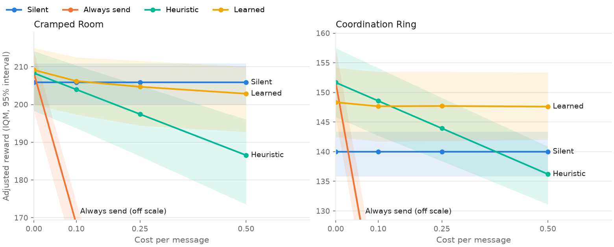

# Selective intention communication in Overcooked-AI

Can two agents coordinate better if one tells the other what it plans to do?
In this pilot, sharing an intention every tick increased average team reward
by 2.9% on Cramped Room and 10.8% on Coordination Ring. The agents also got in
each other's way less often on both maps.

## What we built

[`pilot.py`](pilot.py) runs two scripted agents in Overcooked-AI. The agents
choose tasks with rules and use shortest-path search to reach the relevant
kitchen tile. The same controller runs in both conditions.

Each tick, one agent picks a task and target tile first. In the **silent**
condition it keeps that choice private. In **always-send** it tells its partner
what it plans to do, or sends an idle message if it has no task. If both want
the same exclusive target and the sender has a clear route and can get there
at least as quickly, the receiver picks another task or waits. The message
expires after that decision. Overcooked-AI applies both actions together, and
the agents swap sender and receiver roles on the next tick.

We ran 24 pairs of 400-tick episodes on each map. Within each pair, both
conditions used the same seed for starting orientations, route tie-breaking,
the first sender, and collision recovery choices.

## What happened

Values are averages per episode. Team reward is the simulator's raw reward,
and orders are completed soup deliveries. A blocked move is an attempted move
onto a floor tile that the simulator cancels because of a player collision.
We count a duplicate commitment when both agents choose the same exclusive
target on the same tick, such as the final ingredient slot in a pot.

| Layout | Condition | Team reward | Orders | Messages | Blocked moves | Duplicate commitments |
| --- | --- | ---: | ---: | ---: | ---: | ---: |
| Cramped Room | Silent | 199.17 | 9.96 | 0 | 80.04 | 47.33 |
| Cramped Room | Always-send | 205.00 | 10.25 | 400 | 68.38 | 31.33 |
| Coordination Ring | Silent | 139.17 | 6.96 | 0 | 197.75 | 25.33 |
| Coordination Ring | Always-send | 154.17 | 7.71 | 400 | 185.63 | 12.04 |

On Cramped Room, always-send earned more reward in 7 pairs, tied in 15, and
earned less in 2. On Coordination Ring, the counts were 12, 9, and 3.
The [saved traces](pilot-results.json) show decisions from the same state
with and without a message. On Cramped Room, the receiver waits after
learning that its partner is heading to start the soup. On Coordination Ring,
the receiver turns toward a different onion dispenser.

## Conflict-based sending

After choosing its task, the sender checks if the teammate could use the same
exclusive target given the visible kitchen state and what the teammate holds.
For example, two agents carrying onions can compete for the last slot in a
pot. The sender sends only if it has a route around the teammate and can reach
the target at least as quickly. The receiver chooses its intention and action
after this decision.

We evaluated the rule on the original 24 paired seeds per layout. The random
policy makes an independent send decision each tick. We calibrated its rate
on seeds 100–123 per layout and averaged eight random runs per evaluation seed.
Values are interquartile means (IQMs) over seeds. The gain is the rule's IQM
minus the random policy's IQM, with a paired bootstrap 95% interval (see
[Statistics](#statistics)).

| Layout | Rule reward | Rule messages | Random reward | Random messages | Paired reward gain (95% interval) |
| --- | ---: | ---: | ---: | ---: | ---: |
| Cramped Room | 208.33 | 39.50 | 201.88 | 46.85 | +6.46 (−1.25 to +13.75) |
| Coordination Ring | 151.67 | 30.00 | 139.38 | 26.98 | +12.29 (+1.67 to +25.00) |

The rule matched always-send reward on every paired seed. On average it used
89.1% fewer messages on Cramped Room and 92.4% fewer on Coordination Ring. The
interval for Cramped Room includes zero. The interval for Coordination Ring
favors the rule. The mean-based comparison agrees: +4.48 (−0.21 to +9.69) and
+14.90 (+5.10 to +25.31). See [heuristic-results.json](heuristic-results.json)
for per-seed metrics, both statistics and the calibration rates.

## Learned sending

The learned policy uses the same send decision as the other policies. At a
potential conflict, its inputs are the sender's task, its distance to the
target, how many steps sooner it can get there than the teammate, and the
number of ticks left in the episode. The gate stays silent on the final tick,
when an eligible message cannot change team reward.

### Q update

The policy is fit with undiscounted, finite-horizon Q-learning over the send
gate's decisions ([`learned.py`](learned.py)). A decision is one eligible
conflict, described by features `x = (task, sender steps, lead)`, where
sender steps is capped at 4 and lead at 3. The time left in the episode is
`t = HORIZON − tick`. The two actions are `a ∈ {silent, send}`.

**Paired transitions.** Each training episode runs with random sending at an
exploration rate of 0, 0.5 or 1 per eligible conflict, cycling across seeds.
At up to four sampled conflicts, we rerun the episode with the opposite
choice at that tick only. Both runs use the same simulator seed and the same
gate random stream, so they stay identical before the decision. For each
branch we record:

- `r_k`: team reward `k` ticks after the decision, up to the next eligible
  conflict or the end of the episode.
- `Δ`: ticks until that next conflict.
- `x′`: the features at that conflict, or none if the episode ended first.

**Target.** For a branch observed from a decision with `t` ticks left:

```
y(t) = Σ_{k < min(Δ, t)} r_k  +  max_a′ Q(t − Δ, x′, a′)
```

The bootstrap term is zero when there is no `x′` or when `t − Δ ≤ 1`,
because the gate stays silent on the final tick. An unseen `(t, x′)` also
counts as zero. The max makes the update off-policy. Only rewards up to the
next conflict come from the exploration policy. Later rewards come from the
greedy fitted values.

**Update.** With `c` as the cost per message, and averaging over the
transitions `P(t, x)` pooled for that state:

```
Q(t, x, silent) = mean_{p ∈ P(t, x)} y_silent(t)
Q(t, x, send)   = mean_{p ∈ P(t, x)} y_send(t)  −  c
```

The cost is charged once, on the send branch, for the current message. No
message can be sent between eligible conflicts. Later messages pay their cost
through the bootstrapped `Q(·, send)` values.

**Fitting order and pooling.** `t` runs from 2 up to `HORIZON`. Every
bootstrap reads a strictly smaller `t − Δ`, so the targets are already
final when they are used. This makes one backward-induction sweep, not
an iterative fit. Data is sparse at each exact tick, so `P(t, x)` pools all
transitions with the same features whose recorded time left falls in the
same 25-tick band as `t`. Each one is then re-targeted with the exact `t`.
Rewards past `t` are dropped, and the bootstrap is read at `t − Δ`. A
transition recorded with fewer than `t` ticks left is used only if both
branches reached a next conflict. Otherwise the episode end would have cut
off rewards that a longer horizon would have counted.

**Acting.** The gate sends when `Q(t, x, send) > Q(t, x, silent)`. It stays
silent on ties, on unseen states, on ineligible ticks and on the final tick.
The same paired transitions are refit for each message cost, which gives one
policy per cost.

We trained separately on each layout using 512 seeds (1000–1511), with up
to four paired decisions sampled per seed. We evaluated all costs and
baselines on the same 48 held-out seeds (2000–2047) per layout. The random
baseline for the learned gate uses the same eligible conflict opportunities.
We calibrated its per-opportunity probability on seeds 100–123 to approximate
the learned gate's mean message count at each cost.

## Cost sweep

All four conditions are scored on the same 48 held-out seeds at each message
cost. Adjusted reward is team reward minus the cost times messages sent, per
episode. Silent, always-send and the heuristic do not change with cost, so only
their adjusted reward moves. The learned gate is refit for each cost.



Shaded bands are bootstrap 95% intervals for each condition's IQM.
Always-send pays for 400 messages per episode and leaves the plotted range
by a cost of 0.10.

| Layout | Cost | Silent | Always send | Heuristic | Learned | Learned messages |
| --- | ---: | ---: | ---: | ---: | ---: | ---: |
| Cramped Room | 0.00 | 205.83 | 208.33 | 208.33 | 209.17 | 12.29 |
| Cramped Room | 0.10 | 205.83 | 168.33 | 203.98 | 206.22 | 12.29 |
| Cramped Room | 0.25 | 205.83 | 108.33 | 197.45 | 204.71 | 10.25 |
| Cramped Room | 0.50 | 205.83 | 8.33 | 186.56 | 202.88 | 8.17 |
| Coordination Ring | 0.00 | 140.00 | 151.67 | 151.67 | 148.33 | 6.08 |
| Coordination Ring | 0.10 | 140.00 | 111.67 | 148.57 | 147.66 | 5.92 |
| Coordination Ring | 0.25 | 140.00 | 51.67 | 143.94 | 147.71 | 5.33 |
| Coordination Ring | 0.50 | 140.00 | −48.33 | 136.21 | 147.60 | 4.54 |

Values are IQM adjusted reward, and the last column is the learned gate's IQM
messages per episode. The heuristic sends a mean of 44.8 messages on Cramped
Room and 29.2 on Coordination Ring at every cost.

Paired differences in IQM adjusted reward, with bootstrap 95% intervals:

| Layout | Cost | Learned − silent | Learned − heuristic | Learned − random | Heuristic − silent |
| --- | ---: | ---: | ---: | ---: | ---: |
| Cramped Room | 0.00 | +3.33 (−5.83 to +10.00) | +0.83 (−5.83 to +8.33) | +0.94 (−6.04 to +5.21) | +2.50 (−6.67 to +9.17) |
| Cramped Room | 0.10 | +0.39 (−7.80 to +6.80) | +2.25 (−4.45 to +10.55) | −0.71 (−7.76 to +4.18) | −1.85 (−12.15 to +5.67) |
| Cramped Room | 0.25 | −1.12 (−10.68 to +5.45) | +7.26 (−0.09 to +15.39) | −0.02 (−8.96 to +6.01) | −8.39 (−19.55 to +0.02) |
| Cramped Room | 0.50 | −2.96 (−12.65 to +3.92) | +16.31 (+8.08 to +25.71) | +0.66 (−8.60 to +7.38) | −19.27 (−32.19 to −8.96) |
| Coordination Ring | 0.00 | +8.33 (+2.50 to +15.00) | −3.33 (−10.83 to +4.17) | +4.69 (−1.25 to +10.00) | +11.67 (+5.00 to +18.33) |
| Coordination Ring | 0.10 | +7.66 (+1.79 to +14.34) | −0.92 (−8.48 to +6.58) | +5.02 (−0.93 to +10.47) | +8.57 (+2.22 to +15.06) |
| Coordination Ring | 0.25 | +7.71 (+1.79 to +14.39) | +3.77 (−3.83 to +11.46) | +7.67 (+1.64 to +13.21) | +3.94 (−2.02 to +10.16) |
| Coordination Ring | 0.50 | +7.60 (+2.06 to +14.00) | +11.40 (+3.83 to +18.77) | +8.95 (+3.29 to +14.33) | −3.79 (−9.60 to +2.02) |

"Random" is the random gate with the learned gate's eligibility rules,
calibrated to its message budget at each cost.

On Coordination Ring, the learned gate beat silence at every cost. It beat the
matched random gate at 0.25 and 0.50, and the heuristic at 0.50. The
heuristic's advantage over silence shrinks as cost rises, because it sends
about 29 messages per episode to the learned gate's 5 or 6. On Cramped Room, no learned-gate interval excludes
zero against silence or random. The learned gate beat the heuristic at 0.50,
and the heuristic fell below silence there. By mean adjusted reward, silence
led the learned gate by 2.02, 4.32 and 6.09 points at the three positive costs
on Cramped Room. The IQM drops the top and bottom quarter of episodes, so the
two statistics can disagree in size. See
[learned-results.json](learned-results.json) for every pairwise comparison,
both statistics and per-seed metrics.

## Statistics

Each condition is summarized by its interquartile mean (IQM) over evaluation
seeds: the mean after dropping the lowest and highest quarter of episodes,
as in `scipy.stats.trim_mean(x, 0.25)`. IQM is less sensitive to a few
unusual episodes than the mean and less noisy than the median. A
condition's interval is a 2000-sample percentile bootstrap over seeds. A
comparison between two conditions reports the difference of their IQMs. Each
bootstrap sample draws seeds with replacement and uses the same seeds for
both conditions, so the interval keeps the seed pairing. The results files
also keep the mean and the bootstrap interval of the per-seed mean
difference. Random baselines average eight runs per seed before the
summary.

## Code

| File | What it does |
| --- | --- |
| [`pilot.py`](pilot.py) | Scripted controller, the silent, always-send and heuristic gates, and the episode loop. Runs the silent vs always-send pilot. |
| [`learned.py`](learned.py) | Paired replay and the finite-horizon Q fit for the learned gate. |
| [`experiments.py`](experiments.py) | Random baselines and their calibration, IQM and bootstrap statistics, and the heuristic and cost-sweep experiments. |
| [`plots.py`](plots.py) | Draws the cost-sweep figure from `learned-results.json`. |
| [`test_learned.py`](test_learned.py) | Unit tests for the Q targets, the eligibility rules, budget matching and the statistics. |

## Run it locally

Use Python 3.12 and [uv](https://docs.astral.sh/uv/). The simulator revision is
pinned in [`requirements.txt`](requirements.txt).

```sh
uv venv --python 3.12
uv pip install -r requirements.txt
.venv/bin/python -m unittest
.venv/bin/python pilot.py --output /tmp/overcooked-pilot.json
cmp pilot-results.json /tmp/overcooked-pilot.json
.venv/bin/python experiments.py heuristic --output /tmp/overcooked-heuristic.json
cmp heuristic-results.json /tmp/overcooked-heuristic.json
.venv/bin/python experiments.py learned --output /tmp/overcooked-learned.json
cmp learned-results.json /tmp/overcooked-learned.json
.venv/bin/python plots.py --results learned-results.json --output figures/cost-sweep.png
```

[`pilot-results.json`](pilot-results.json) contains both conditions' metrics
for each seed and one controlled trace per map.
